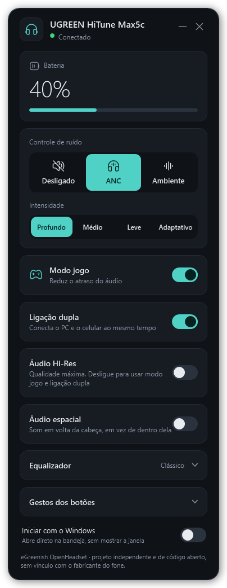

# eGreenish OpenHeadset

A small Windows tray app to control Bluetooth headsets that have no desktop software: battery, noise control and
game mode. **Open to any brand:** supporting a new headset means adding one profile, not rewriting the app.

[Leia em Português](README.pt-BR.md)



> [!IMPORTANT]
> Independent community project. It is not affiliated with, endorsed by, or supported by any headset manufacturer.
> Product names are trademarks of their owners and are used only to say what the app works with.

## Supported headsets

| Brand | Model | Battery | Noise control | Game mode | Tested on |
|-------|-------|:-------:|:-------------:|:---------:|-----------|
| UGREEN | HiTune Max5c | yes | off / ANC (4 levels) / ambient | yes | one unit, Windows 10 19045 |

Only what was verified on a real headset is listed. A control is sent only after it was seen to work, and the app
reads the headset's answer back afterwards; if the headset does not confirm a change, the app tells you and never
tries other commands. The window is currently in Portuguese; translations are welcome.

**Your headset is not here?** You can add it. See [Add a headset](#add-a-headset).

## Use

1. Pair the headset in the Windows Bluetooth settings and connect it.
2. Run `OpenHeadset.exe`. The window finds a supported headset and shows its state.
3. The close button hides the window to the tray. Use the tray menu to quit. Opening the app again brings the window back.
4. Optional: turn on the *Iniciar com o Windows* switch (start with Windows) to launch it at sign-in, straight to the tray with no window. It is off by default and only touches your own user account.

Windows 10 or later, x64. The download is self-contained: no .NET install is needed.

## How it works

Windows creates a serial (COM) port for a headset's Bluetooth serial service. The app locates that port from the
Windows device IDs and exchanges small framed messages with the headset. Each model has a **profile**: its Bluetooth
name, what it can do, and a protocol that knows the bytes. The window builds its controls from what the profile
declares, so a headset without transparency mode simply shows no such button.

```
OpenHeadset.Core        neutral types and the contract every headset implements
OpenHeadset.Profiles    one folder per brand: a profile + a protocol for each model
OpenHeadset.Transport   finds the headset in Windows and talks over its serial port
OpenHeadset.App         the tray window
```

## Add a headset

1. Pair it and run `dotnet run --project tools/OpenHeadset.Probe -- list` to see whether it has a COM port.
2. Learn its protocol from **your own** headset (the capture tool and an Android Bluetooth log are enough).
3. Add a profile under `src/OpenHeadset.Profiles/<Brand>/` and one line in `BuiltInProfiles.cs`.
4. Add tests with the real bytes you captured; a contract test already checks every profile.
5. Open a pull request.

Full guide: [docs/adding-a-headset.md](docs/adding-a-headset.md). Please read the safety and clean-room rules in
[CONTRIBUTING.md](CONTRIBUTING.md) first: your own hardware only, observed commands only, nothing destructive, and no
code or keys taken from a vendor's app. Per-model notes live in [docs/protocols](docs/protocols).

Headsets that expose controls only over Bluetooth Low Energy are not supported yet; see the guide.

## Build

```powershell
dotnet test tests/OpenHeadset.Tests
dotnet publish src/OpenHeadset.App -c Release -r win-x64 --self-contained true -o artifacts/OpenHeadset
```

Needs the .NET 10 SDK.

## License

[MIT](LICENSE). Icons are from [Reicon](https://reicon.dev) (MIT), see [THIRD_PARTY_NOTICES.md](THIRD_PARTY_NOTICES.md).
